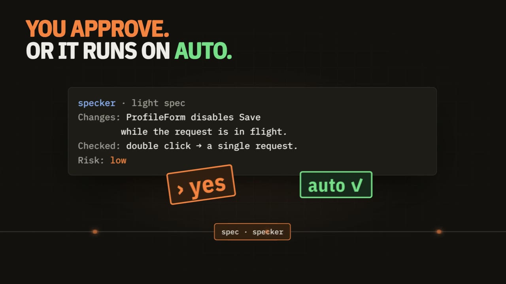

# code-factory

A team of [Claude Code](https://claude.com/claude-code) agents that turns a request ("add X to screen Y", a ticket) into a **reviewed and tested pull request**. You describe the work; an orchestrator hands it to a coordinator, which runs spec → plan → implementation → quality gate → review → tests → PR, each step in its own agent and git worktree. You approve at the points you choose.

It is an engine, not a project: any number of **hubs** (one folder per project, with its own `workspace.json`, context and specs) use the same engine. A change to the engine reaches every hub at once; there is no build step.

[](docs/media/code-factory-demo.mp4)

<sub>25-second demo (click to play). Made with [HyperFrames](https://github.com/heygen-com/hyperframes) from this repo.</sub>

```
you ──► orchestrator ──► coordinator (one per task, own worktree)
                           ├─ specker / scout        spec and plan
                           ├─ worker(s)              implementation
                           ├─ gate                   lint, types, tests (scripts, no tokens)
                           ├─ reviewer / tester      fresh-context review, tests
                           └─ ui-designer / ui-tester   design and on-screen checks
                         ──► PR ──► review loop ──► merge
```

## Status

Early and opinionated. It was built for and used on real projects, but expect rough edges.

- **macOS only** for now (BSD `sed`, `open`).
- Built on Claude Code; a Cursor provider can take over coordinators when a Claude usage window is nearly spent. Other CLIs are on the [backlog](#roadmap).
- Experimental: per-agent [Code Mode](docs/34-best-practices.md#experimental-code-mode).

## Requirements

[Claude Code](https://claude.com/claude-code) (with an account), [Herdr](https://herdr.dev) (terminal multiplexer, tested with 0.9.5), [OpenSpec](https://github.com/Fission-AI/OpenSpec), `git`, `gh`, `jq`, `node`, `python3`. Optional: `fzf`, `git-delta`, `lazygit`, `neovim`, Ghostty, Docker, `cursor-agent`. Details in [docs/10-instalar.md](docs/10-instalar.md).

## Quick start

```sh
git clone <this repo> ~/code-factory
~/code-factory/install.sh            # checks tools, links ~/.local/bin/factory

factory hub-init ~/projects/my-hub my-store
cd ~/projects/my-hub
ln -s ../my-repo my-repo             # link your repos, edit workspace.json and AGENTS.md
factory orchestrator -n orchestrator # inside Herdr
factory task "Add a dark-mode toggle to the settings screen"
```

A complete example hub, filled in for a fictional bookshop (a finished task, decisions, learnings, a custom panel and tracker), is in [`examples/pagelight-hub/`](examples/pagelight-hub/). The full walkthrough is six short pages, starting at [docs/README.md](docs/README.md); `factory docs` opens them as a searchable web page.

## Documentation

| | |
|---|---|
| **Start here** | [Install](docs/10-instalar.md) → [Create a hub](docs/11-crear-un-hub.md) → [Configure](docs/12-configurar.md) → [Start up](docs/13-arrancar.md) → [First task](docs/14-primera-tarea.md) → [Day to day](docs/15-dia-a-dia.md) |
| **How it works** | [Architecture](docs/20-arquitectura.md) · [Task lifecycle](docs/21-ciclo-de-una-tarea.md) · [Quality](docs/24-calidad.md) · [Delivery](docs/25-entrega.md) |
| **Reference** | [Tools](docs/30-herramientas.md) · [Configuration](docs/31-configuracion.md) · [Agents](docs/32-agentes.md) · [Known limits](docs/33-limites.md) |
| **Guide** | [Best practices](docs/34-best-practices.md): safety, verification, short instructions, Code Mode |

## Make it yours

The skeleton is the agents, the kit, the gate, OpenSpec and the worktrees. The rest is replaceable:

- **Task tracker:** none, Notion (shipped) or your own adapter, a `TRACKER.md` with four operations: [`trackers/README.md`](trackers/README.md).
- **Panels:** each panel is a shell script that prints rows; add yours in `<hub>/panels/<name>.sh` and list it in `panels.hub`: [`panels/README.md`](panels/README.md).
- **Terminal runtime:** Herdr today. Making it swappable is on the [roadmap](#roadmap).

## A note on safety

Agents run commands and open PRs on your behalf. Read [Best practices](docs/34-best-practices.md#safety-what-is-enforced-and-what-is-a-request) before pointing it at anything you cannot restore. The kit ships `deny` rules that stop agents reading `.env*` files; a prompt alone is not a guarantee, and `deny` rules do not stop a script an agent runs from opening a file. Try changes to the engine in a throwaway hub (`factory hub-init`), never in a live one.

## Roadmap

Ideas, in rough order: a swappable terminal runtime (so Herdr is optional), a web dashboard of tasks and agents (`factory dash` draws the agent tree today), sessions on other machines over SSH, and any agent CLI as a provider (Codex, Gemini, OpenCode…).

## Contributing

Read [AGENTS.md](AGENTS.md): what belongs in the engine and what in a hub, how to test without touching a live hub, and the traps that already cost time. Update `docs/` in the same change and make sure `factory docs --check` is clean.

## License

[MIT](LICENSE)
