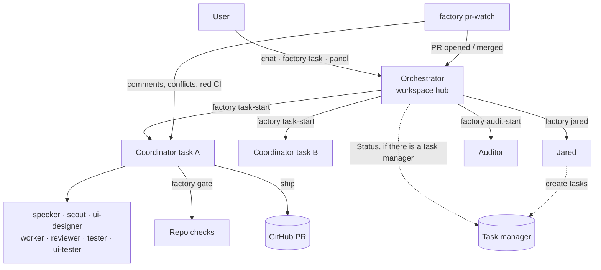

# Architecture

## Layers

| Layer | What it is | Where |
|---|---|---|
| **Engine** | This repo (`code-factory`): kit, scripts, panels, OpenSpec schema, hub template. Shared by all hubs; it knows nothing about any project. | `kit/`, `bin/`, `panels/`, `openspec/schemas/factory`, `templates/hub/` |
| **Hub** | A project's folder: repo map, config, specs, decisions, testing guides, learnings and task state. | `workspace.json`, `AGENTS.md`, `openspec/`, `briefs/`, `testing/`, `learnings/`, `.board/`, `.tasks/` |
| **Repos** | The product repos, linked inside the hub, each with its own git and its own rules (`AGENTS.md`). Each one has **roles** in `workspace.json`: `ui`, `api`, `infra`. | `<hub>/<repo>` |
| **Kit** | The `factory` Claude Code plugin: agents, skills, hooks, MCP. It is loaded per session with `--plugin-dir <engine>/kit`. | `kit/agents/`, `kit/skills/`, `kit/hooks/`, `kit/mcp/` |
| **Scripts** | Deterministic Bash/Python for everything that doesn't need a model: preparing branches and worktrees, the gate, watching PRs, panels. You call them with `factory <command>`. | `bin/`, `panels/`; the hub's own in `<hub>/bin/` |
| **Herdr** | Terminal multiplexer: one *workspace* per main session, with side panels. Agents talk to each other with `herdr agent prompt`. | skill `factory:herdr` |

**Golden rule:** each repo rules itself (stack, commands, branches, tests). The hub doesn't duplicate that; if it contradicts the repo, the repo wins. And the engine doesn't name a project's repos, branches or services: it reasons by role (`the repo with role ui`) and by config key (`repos.<repo>.base`).

## Main sessions and subagents

A **main session** is a `claude` process with its own Herdr workspace; a **subagent** lives inside a session and returns a report to it.

| Session | Agent | Model | Launched by |
|---|---|---|---|
| Orchestrator | `factory:orchestrator` | Sonnet | `factory orchestrator` (= `factory claude-kit orchestrator`) |
| Coordinator (one per task) | `factory:coordinator` | Opus | `factory task-start` |
| Senior coordinator (in its place, structural UI work) | `factory:senior` | Fable | `factory task-start --senior` |
| Jared | `factory:jared` | Sonnet | `factory jared` |
| Auditor | `factory:auditor` | Sonnet | `factory audit-start` |
| Changelog | `factory:changelog` | Sonnet | `factory changelog [period]`, or ask the orchestrator |

The senior is a coordinator with the same flow and team, for redesigns, migrations to a component library or a design system: it writes the `design-plan.md` itself (tokens, components by layer, order by batch) and the foundations (theme and a reference component), and hands out the rest to workers, one batch each. Fable has its own quota, so it doesn't spend the Claude window or jump to Cursor at 95%.

The coordinator is the only session on Opus: it decides, it doesn't execute. The expensive work (reading code, editing, testing) is done by cheaper subagents; the worker's and reviewer's model comes from the task's risk (`routing`, [Spec and plan](23-spec-y-plan.md#risk-and-routing)). Details of each one in the [agent reference](32-agentes.md).

All of them start with `--settings "$(bin/lib/kit-settings)"`, which passes them `FACTORY_HUB` and `FACTORY_HOME` and gives access to the engine ([Hubs, sessions and extensions](27-hubs-y-sesiones.md#kit-sessions)). The coordinator also gets `--add-dir` for the hub and for the real path of each repo in the task.

**When a kit change is picked up:** when the session starts. A running coordinator keeps the kit it started with; `factory task-start` always loads the current one. The config each task ran with is stored in `.board/tasks/<task>.json`.

## Context and cost

Rules shared by all main sessions (the **Context** block of their prompts):
- At most `claude.parallel` subagents at a time (2 by default).
- A request carries paths, line ranges and the question; never the body of a file or a diff.
- What comes back fits in a few dozen lines with `path:line`; if it's more, the subagent writes it to a file and returns the path (e.g. each round's reports in `rounds/<N>/`).
- A worker is reused per repo (you send it only the delta) for up to 2 fix rounds or ~60k tokens of context; reviewer, tester and ui-tester are always new, so they read without bias.

`factory ctx [N | <task>]` measures, from the transcripts, the context of each agent in the latest tasks: baseline, peak, turns, compactions and which tools filled it.

## Where each piece of state lives

Paths are relative to the hub.

| Path | Contents | Written by | Read by |
|---|---|---|---|
| `.board/inbox/<date>-<slug>.md` | Tasks waiting to be launched (`factory task`, panel `tareas`); once launched → `done/` | `factory task`, orchestrator | orchestrator |
| `.board/requests/<task>.md` | The request as the orchestrator left it | orchestrator | specker |
| `openspec/changes/<task>/` | Full task: `proposal.md`, `specs/`, `tasks.md`, `ui.md`, `result.md`, `rounds/<N>/` | specker, coordinator, reviewer, ui-designer | everyone |
| `briefs/<task>/` | Light task: `brief.md`, `ui.md`, `result.md`, `rounds/<N>/` | same | everyone |
| `openspec/specs/` | Current requirements (they grow on archive) | `factory task-end` | specker |
| `.tasks/<task>/<repo>` | Each repo's working folder: link to the main checkout or worktree | `factory task-start`, `factory task-move` | coordinator and team |
| `.board/tasks/<task>.json` | Config the task ran with and its Herdr workspace | `factory task-start` | `factory task-end` |
| `.board/setup/<task>-<repo>.log` | Output of the worktree `setup` | `factory task-start` | coordinator |
| `.board/gate/<task>/<repo>.{log,txt}` | Full output and summary of the gate | `factory gate` | worker (the log), coordinator (the summary) |
| `.board/shots/<task>/` | Screenshots, crops and `evidence.json` from the on-screen test | ui-tester | user, ui-designer, panel `recursos` |
| `.board/<session_id>` | Subagents of each Claude session (for the board). Cursor ones are read from its transcript, because the hook doesn't run there | hook `subagents.sh` | `factory board` |
| `.board/kit-settings.json` | Settings of this hub's kit sessions | `bin/lib/kit-settings` | `claude` |
| `.board/pr-watch.log`, `.board/sys-watch.log` | What the watchers did | `pr-watch`, `sys-watch` | user |
| `learnings/<repo>.md`, `learnings/workflow.md` | Pitfalls and recipes with date and task | retro (with your "yes") | coordinator, specker, ui-designer |
| `testing/<repo>/**/TESTING.md` | Testing guides: environments, users by role, data | retro, by hand | tester, ui-tester, coordinator |
| `audits/<repo>/<date>-<types>/` | Audit reports | auditor | user |
| `changelogs/<date>/` | The period's `index.html` and `CHANGELOG.md`, `videos/` (mp4, gif, poster and Hyperframes project for each item; raw takes in `raw/`) | changelog, ui-tester (`demo`), video-editor | user |
| `changelogs/GUIDE.md`, `template.html`, `assets/` | What the hub's changelog looks like: audience, tone, brand, videos and page design | user | changelog, video-editor |
