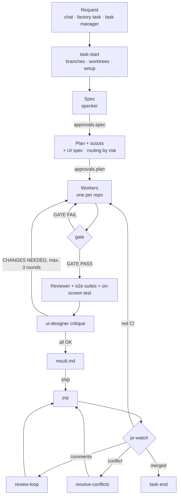

# Task lifecycle



## 1. Request and start · orchestrator

1. It reads the request: from the chat, from a file in `.board/inbox/` (`factory task`) or, with a task manager, from the ticket (`factory notion-page <ticket>`). It decides which repos are involved using the map in the hub's `AGENTS.md`. It sends a scout only if it doesn't know.
2. It names the task `<ticket>-<slug>` (or a 2-4 word slug if there is no ticket) and picks the branch and base per repo, from the table in `AGENTS.md` and `repos.<repo>.base`.
3. It writes `.board/requests/<task>.md` and launches, without asking:
   ```sh
   factory task-start <task> <repo>:<branch>:<base> [...]
   ```
   With `--senior` before `<task>` it starts the senior coordinator ([architecture](20-arquitectura.md)): for a UI redesign or migration; the request names the design source and the target.
   If it came from the inbox, it moves the file to `.board/inbox/done/`.
4. With a task manager, it moves the ticket to `notion.status.started`.

`factory task-start` (a lock keeps two starts from stepping on each other; it refuses if the task already has a workspace):
- Per repo it decides **main checkout or worktree** ([Repos, worktrees and environments](22-repos-worktrees-entornos.md)). In a worktree it copies the ignored `.env*` files from the main checkout (without opening them) and runs `repos.<repo>.setup` if there is one; with `repos.<repo>.taskServers`, it calls the hub's `task-servers` to give it its servers.
- It saves the config in `.board/tasks/<task>.json` (including `provider`: claude or cursor), opens a Herdr workspace with the detail panel and starts the coordinator with a short first message: `Task … Repos here: web (ui) api (api). Plan approval … Ship … UI tests … UI before … UI env …`. The roles come from `repos.<repo>.roles`; the coordinator plans by role. With the provider set to Claude and a usage window at 95% or more, that coordinator starts on Cursor; the orchestrator stays on Claude ([provider](27-hubs-y-sesiones.md#provider-claude-or-cursor)).

## 2. Spec · specker

With no prior spec, the coordinator calls the specker, which chooses **full** (an OpenSpec change) or **light** (`briefs/<task>/brief.md`), reads the code it needs and returns a summary with decisions, **risk** and questions. With `approvals.spec: ask` it waits for your "yes"; with `auto` it carries on with the defaults. Details in [Spec and plan](23-spec-y-plan.md).

## 3. Plan · coordinator

1. It reads the spec, each repo's `AGENTS.md` and `learnings/`. Using the spec's **Risk** section it picks the `routing` row: worker model, reviewer model and effort and, if the row says so, plan approval.
2. It launches scouts (Haiku) with concrete questions: which files, how something similar is done, which tests cover it.
3. If the task changes what a user sees in a `ui` repo, it launches the **ui-designer in `plan` mode** at the same time; its answer is saved as `ui.md` next to the spec.
4. It writes the per-repo plan (with a **Rules** line: the repo rules that apply) and, with `uiTests: on` and code in a `ui` repo touched, the **on-screen test plan**: environment, numbered flows, screenshots, data.
5. `approvals.plan: ask` → it waits for your "yes"; `auto` → it carries on and leaves doubts as "Decision: …".

## 4. Early warning · `ui-preflight`

Only for tasks with a screen (skill `ui-test`). While the workers start, if the hub has `factory ui-preflight`, the coordinator runs it itself (seconds, no agent) and asks you at once for whatever only you can do (start docker, switch the backend, create data). Nobody waits for it.

## 5. Implement · workers

One worker per repo, in parallel up to `claude.parallel`, because the contract is already fixed in the spec. Each worker reads the repo's rules, builds exactly its part of the plan (and `ui.md` if there is one) and verifies with the tests for what it touches.

## 6. Gate

Before any reviewer or tester, the coordinator runs `factory gate <task>`: types, lint and unit tests for what was touched, using the commands in the hub's `gate.repos.<repo>.checks` (never from the branch). No tokens. `GATE FAIL` → the `✗` lines and the log path go to the worker, and the gate runs again; after 3 retries, `FAILING`. Details in [Quality](24-calidad.md#gate).

## 7. Review and test

In parallel, within the same limit:
- **reviewer**: diff against the plan, bugs, forgotten calls, repo rules, both sides of the contract, and each `protected:` / `silenced:` from the gate.
- **tester**: only the repo's e2e tests for what was touched (the gate already passed types, lint and unit tests); none if the diff doesn't touch code that runs. If it shares the task's fronts with the ui-tester, they run one after the other, never at the same time.
- **ui-tester `ui`** (tasks with a screen): brings up what the flows need (preflight, services, data, users), runs them with Playwright and takes the screenshots. A `BLOCKED` is asked to you once; if it persists, the flows move to "manual QA".
- **ui-designer `critique`**: after `ui` (or after a ui-tester `capture` if there is no on-screen test), it judges screenshots, crops and measurements against `ui.md`.

Each review writes its report in `rounds/<N>/` next to the spec (`review.md`, `critique.md`) and returns only the verdict.

## 8. Fix loop

- The task is ready only with reviewer `APPROVE`, all testers `OK` and, with `ui.md`, critique `APPROVE`.
- Blocking findings go **to the same worker** of the repo: the path of the round file and the numbers of its findings. Optional ones go to "Pending".
- Each round: gate, a new reviewer on the delta, suites narrowed to what changed, `ui` if front code was touched and a new critique if the previous one blocked.
- **Maximum 3 rounds.** If it isn't ready: `Status: FAILING` and it stops.
- A new worker replaces the previous one when the reviewer rejects the approach, the change is in a different area, it has already done 2 rounds or its context exceeds ~60k tokens.

## 9. Result and delivery

1. `result.md`, in English: status, rounds, **⚠ Needs attention** (high risk, `attention:` lines from the gate, accepted `protected:`/`silenced:`, default decisions), changes per repo, on-screen test, manual QA and pending items.
2. **Ship** according to `ship`: commit only the task's files, push and one PR per repo (`api` first), with the screenshots.
3. **Cleanup** (tasks with a screen): the coordinator stops the services the ui-tester left running in the servers panel.
4. **Retro**: it proposes learnings and writes them only with your "yes".

## 10. PR life

`factory pr-watch` (every 2 min, `gh` only) notifies:
- the **orchestrator**: PR open in all repos → task manager to `status.pr`; all merged → `status.merged` (and `factory task-end` if the coordinator is gone).
- the **coordinator**: all merged → it closes the task with `factory task-end`, which also closes its workspace.
- the **coordinator**: new review comments → skill `review-loop`; conflict with the base → `resolve-conflicts`; red CI → if it's the code's fault, one fix round; if not (flaky, infra), it tells you.

Details in [Delivery and follow-up](25-entrega.md).

## Adjustments you ask for midway

At any time you can ask for changes (text or screenshots) in the coordinator's pane. Each one is a mini-loop: scout if needed → the repo's worker → one full fix round (gate → reviewer on the delta → tester) → noted under "Adjustments" in `result.md` → if there was already a PR, push to the same branch.

## Final statuses

| Status | Meaning |
|---|---|
| `VERIFIED` | Gate, reviewer, testers and critique all green |
| `FAILING` | 3 rounds (or 3 gate retries) without success; the report says what fails |
| `BLOCKED` | Something is missing that the team can't start (e.g. the on-screen test couldn't run); it isn't shipped without your "yes" |
